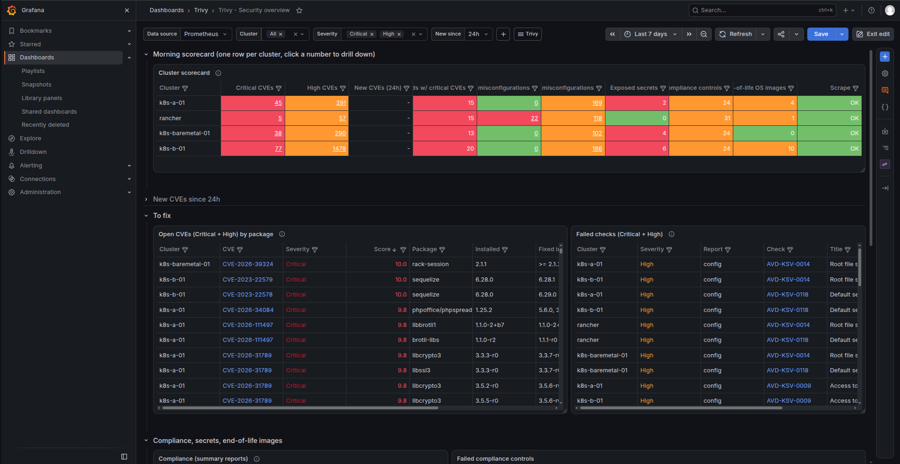

# trivy-grafana

Everyday CVE console: Prometheus + Grafana (a trimmed kube-prometheus-stack) collecting Trivy Operator results from every cluster, so the security team opens one Grafana folder each morning and sees new CVEs, what to fix and where.



## Trivy Operator metrics in Grafana

Helm chart `chart/` (`trivy-grafana`): a thin wrapper around [kube-prometheus-stack](https://github.com/prometheus-community/helm-charts/tree/main/charts/kube-prometheus-stack) (dependency pinned in `chart/Chart.yaml`, trimmed to Prometheus + Grafana) that scrapes the trivy-operator `/metrics` of one or more clusters and ships the Trivy dashboards. It runs on any Kubernetes cluster; Fleet is only one way to install it. Series carry a `cluster` label.

- local cluster: in-cluster service `trivy-operator.trivy-system.svc:80` (`global.observability.localCluster`)
- other clusters: kube-apiserver service proxy `https://<address>:6443/api/v1/namespaces/trivy-system/services/trivy-operator:80/proxy/metrics`, with the token of a ServiceAccount allowed `services/proxy` get in `trivy-system` (here the `kube-system/metrics-reader` ServiceAccount and Role `metrics-reader-trivy-metrics` from the `monitoring-network` repo)

Chart additions to kube-prometheus-stack, all in `chart/templates/`:

| template | values | |
|---|---|---|
| `dashboards.yaml` | `dashboards.enabled`, `dashboards.folder` | one ConfigMap per `chart/dashboards/*.json`, loaded by the Grafana sidecar |
| `grafana-sidecar-Role.yaml` | | ConfigMap-only Role used by the Grafana sidecars instead of the chart's cluster-wide ConfigMap/Secret ClusterRole |
| `httproute.yaml` | `httpRoute.enabled`, `httpRoute.parentRefs` | Gateway API route to Grafana on `global.observability.grafanaHost` |
| `monitoring-egress-NetworkPolicy.yaml` | `ciliumNetworkPolicy.enabled` | Prometheus egress: DNS, in-cluster, downstream apiservers |

### Site values

Hostnames, IPs, Gateway, git repo and the list of clusters go only in `values-site.yaml`, which is ignored by git; `values-site.example.yaml` documents the keys. Each `global.observability.clusters` entry gives one scrape job and its egress rule:

- `name`: `cluster` label, job `trivy-operator-<name>`, keys `<name>-token` / `<name>-ca.crt` in the `trivy-metrics` Secret
- `apiServerName`: TLS server name (must be in the apiserver certificate, e.g. RKE2 `tls-san`), allowed as egress FQDN
- `address`: scrape target; an IP is allowed as egress `/32`. Without a load-balanced apiserver address use a single master (one target only: more masters would scrape the same trivy-operator and duplicate the series), then switch to `apiServerName` once a VIP exists.

### 1. Secrets

On the cluster where the chart runs:

```bash
kubectl create namespace monitoring
kubectl -n monitoring create secret generic grafana-admin \
  --from-literal=admin-user=admin --from-literal=admin-password="$(openssl rand -hex 16)"
```

For the other clusters, one Secret `trivy-metrics` with their tokens (kube contexts named like the clusters):

```bash
TOKEN_SECRET=metrics-reader-token  # token Secret of your ServiceAccount in kube-system
args=()
for c in $(yq -r '.global.observability.clusters[].name' values-site.yaml); do
  kubectl --context "$c" -n kube-system get secret "$TOKEN_SECRET" -o jsonpath='{.data.token}' | base64 -d > "/tmp/$c-token"
  kubectl --context "$c" -n kube-system get secret "$TOKEN_SECRET" -o jsonpath='{.data.ca\.crt}' | base64 -d > "/tmp/$c-ca.crt"
  args+=(--from-file="/tmp/$c-token" --from-file="/tmp/$c-ca.crt")
done
kubectl -n monitoring create secret generic trivy-metrics "${args[@]}"
rm /tmp/*-token /tmp/*-ca.crt

# check from outside, values of one cluster from values-site.yaml
curl --cacert ca.crt -H "Authorization: Bearer $TOKEN" \
  --resolve "$API_SERVER_NAME:6443:$ADDRESS" \
  "https://$API_SERVER_NAME:6443/api/v1/namespaces/trivy-system/services/trivy-operator:80/proxy/metrics" | head
```

`secrets.example.yaml` is the same as manifests.

### 2. Install

With Helm:

```bash
helm dependency build chart
helm upgrade --install kube-prometheus-stack chart -n monitoring -f values-site.yaml
```

With Rancher Fleet (`chart/fleet.yaml`, ignored by Helm): the site values go to the ConfigMap `monitoring/trivy-grafana-site` read with `helm.valuesFrom`, then the GitRepo `fleet/gitrepo.yaml` gets repo and auth secret from `fleetGitRepo` in the same file:

```bash
kubectl -n monitoring create configmap trivy-grafana-site --from-file=values.yaml=values-site.yaml \
  --dry-run=client -o yaml | kubectl apply -f -
yq -y --arg repo "$(yq -r '.fleetGitRepo.repo' values-site.yaml)" --arg auth "$(yq -r '.fleetGitRepo.clientSecretName' values-site.yaml)" \
  '.spec.repo = $repo | .spec.clientSecretName = $auth' fleet/gitrepo.yaml | kubectl apply -f -
```

Change values in git or in `values-site.yaml` (then re-create the ConfigMap), not in the Rancher console. The release name `kube-prometheus-stack` keeps the resource names of the former plain kube-prometheus-stack install.

Upgrade kube-prometheus-stack: bump `dependencies[0].version` in `chart/Chart.yaml`, run `helm dependency update chart`, check the upstream upgrade notes (CRDs).

Grafana is published on `https://<global.observability.grafanaHost>` through the Gateway listener in `httpRoute.parentRefs`; with an external reverse proxy in front, it needs the matching vhost.

### 3. Dashboards (`Trivy` folder)

| dashboard | use |
|---|---|
| Trivy - Security overview | morning report: scorecard per cluster (unique Critical/High CVEs, new CVEs, workloads with critical CVEs, Critical/High misconfigurations, exposed secrets, failed compliance controls, end-of-life OS images, scrape status), new CVEs table, CVEs and failed checks to fix, compliance, 7-day trend |
| Trivy - Vulnerability details | drill-down by cluster/namespace/image/CVE: title, severity, score, package, installed and fixed version, published date, primary link, affected workloads, vulnerable images |
| Trivy - Misconfiguration details | drill-down on failed config audit, RBAC and infra checks: description, remediation link (Aqua AVD), affected resources |
| Trivy Operator - Vulnerabilities | Grafana.com [16337](https://grafana.com/grafana/dashboards/16337) rev 16, vendored with the `cluster`/`namespace` variables patched to trivy-operator metrics (the original reads kube-state-metrics, not scraped here) |

Click a CVE, check, image or scorecard number to open the matching drill-down; CVE cells also link to NVD and OSV. The primary link is rebuilt from the ID (Aqua AVD for CVEs, as in the Trivy report; GitHub for GHSA; OSV otherwise) because trivy-operator does not export it as a metric.

"New CVEs" are Critical/High CVE IDs present now that were never reported for the same cluster in the 7 days before the selected window (24h, 72h on Monday, 7d). A cluster needs at least the window of Prometheus history to be evaluated: Prometheus has no persistent volume, so after a restart the panel stays empty until history builds up again.

The custom dashboards are generated JSON: edit them in Grafana, export, and commit the JSON in `chart/dashboards/`; every `*.json` there becomes a ConfigMap.
